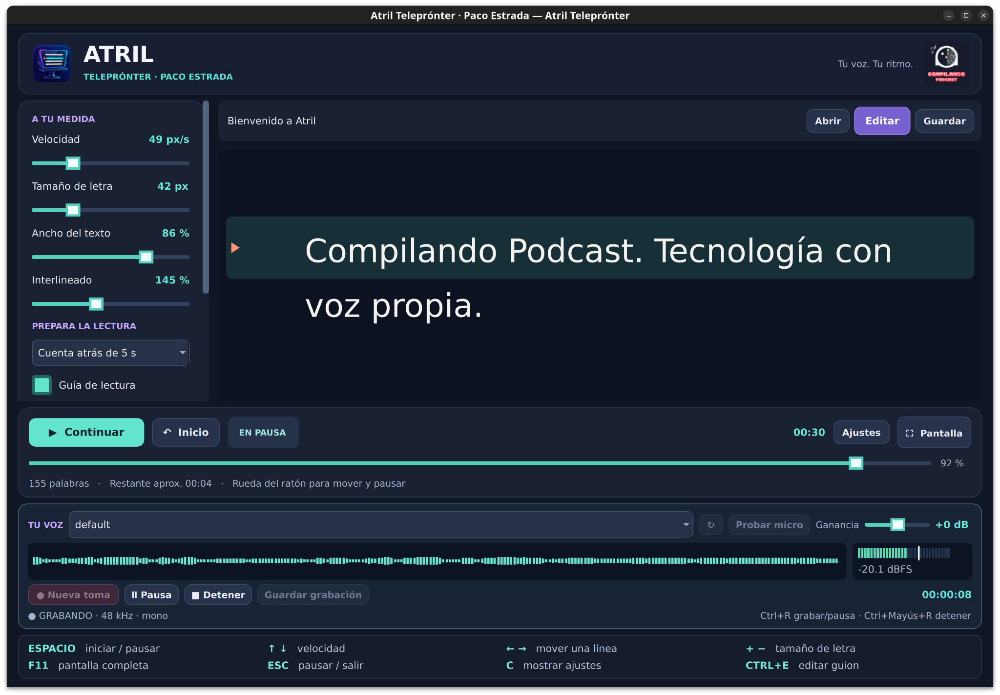

# Atril Teleprónter

**Tu voz. Tu ritmo.** Un teleprónter para GNU/Linux de **Paco Estrada · Compilando Podcast**.

Una aplicación de escritorio para locuciones, vídeos, presentaciones y pódcast. Funciona sin conexión, con letra grande, desplazamiento suave y controles de teclado y ratón. Los atajos más utilizados siguen visibles durante la lectura y en pantalla completa.

## Novedades de la versión 1.2.0

Atril permite **grabar la voz mientras lees el guion**, desde la misma aplicación. Elige la entrada de audio del equipo, prueba el micrófono y ajusta la ganancia antes de grabar. El vúmetro, la forma de onda y el contador ayudan a seguir la toma.

**Guarda en WAV, FLAC o MP3**, con el nombre y la carpeta que prefieras. Puedes pausar, reanudar y detener el audio de forma independiente a la lectura, con el ratón o los atajos de teclado.

Esta función nace de una necesidad de Paco Estrada para sus locuciones y pódcast: tener la lectura y la grabación juntas para simplificar el trabajo. La pista guardada puede llevarse después al editor habitual para añadir música, filtros, efectos o compresión.



Captura de uso real en Linux Mint. Seguiremos mejorando la aplicación y puliendo detalles.

## Descargas de la versión 1.2.0

| Plataforma | Release |
| --- | --- |
| GitHub | [Descargar .deb, .rpm y Arch Linux](https://github.com/pacoestrada/atril-teleprompter/releases/tag/v1.2.0) |
| GitLab | [Descargar .deb, .rpm y Arch Linux](https://gitlab.com/PacoEstrada/atril-teleprompter/-/releases/v1.2.0) |

Descarga `.deb` para Linux Mint, Ubuntu y Debian, `.rpm` para Fedora o `.pkg.tar.zst` para Arch Linux. Los paquetes llevan las mismas fuentes de la versión 1.2.0. `SHA256SUMS.txt` permite comprobar los paquetes y las fuentes descargados.

## Instalar en Linux Mint, Ubuntu o Debian

Descarga `atril-teleprompter_1.2.0_all.deb` y ábrelo con el instalador de paquetes. También puedes instalarlo desde la carpeta de descarga con:

```bash
sudo apt install ./atril-teleprompter_1.2.0_all.deb
```

Después busca **Atril Teleprónter** en el menú de aplicaciones. El ejecutable se llama `atril-teleprompter` para no interferir con el visor de documentos Atril.

Necesita Python 3.10 o posterior, PyQt5 5.15, Qt Multimedia y FFmpeg. El gestor de paquetes instala estas dependencias. Puede necesitar conexión para descargarlas; la aplicación funciona completamente sin conexión una vez instalada. No incorpora servidor, cuenta de usuario ni servicios externos.

## Instalar en Fedora

```bash
sudo dnf install ./atril-teleprompter-1.2.0-1.noarch.rpm
```

El RPM declara las dependencias de Python, PyQt5, Qt Multimedia y FFmpeg. Está preparado para Fedora; no se afirma compatibilidad con todas las distribuciones que usan RPM. No se convierte a partir del paquete Debian.

## Instalar en Arch Linux

Descarga `atril-teleprompter-1.2.0-1-any.pkg.tar.zst` desde la
[release de GitHub](https://github.com/pacoestrada/atril-teleprompter/releases/tag/v1.2.0)
o la [release de GitLab](https://gitlab.com/PacoEstrada/atril-teleprompter/-/releases/v1.2.0).
Desde la carpeta de descarga, con Arch actualizado:

```bash
sudo pacman -Syu
sudo pacman -U ./atril-teleprompter-1.2.0-1-any.pkg.tar.zst
```

El paquete está construido de forma nativa con `makepkg`. Pacman instala
Python, PyQt5, Qt Multimedia y FFmpeg si faltan. También puedes reconstruirlo e instalarlo con la
receta incluida en el repositorio:

```bash
sudo pacman -Syu --needed base-devel git
git clone https://github.com/pacoestrada/atril-teleprompter.git
cd atril-teleprompter/packaging/arch
less PKGBUILD
makepkg -si
```

Ejecuta `makepkg` sin `sudo`. La receta verifica las fuentes de la versión
1.2.0 y ejecuta las pruebas antes de generar el paquete. No está publicada
en AUR. Consulta las [instrucciones de Arch](packaging/arch/README.md) para
instalar un paquete ya construido, comprobarlo o desinstalarlo.

## Empezar

1. Pulsa **Editar** para escribir o pegar tu guion, o **Abrir** para importar un archivo.
2. Ajusta el tamaño de letra, el ancho y la velocidad. Elige una cuenta atrás si la necesitas.
3. Pulsa **Espacio** o **Comenzar**. Pulsa de nuevo para pausar.
4. Usa **F11** para pantalla completa y **C** para ocultar o mostrar los ajustes.

El punto de lectura, el texto y los ajustes se guardan automáticamente en este ordenador. Al abrir de nuevo, la sesión queda en pausa. **Guardar** exporta el texto; **Ctrl+Mayús+S** guarda una sesión `.atril` con sus ajustes y posición para llevarla a otro equipo.

Al sustituir el guion, se conserva una copia del anterior. **Recuperar guion anterior**, en el panel de ajustes, permite recuperarlo. Es una sola copia de recuperación, no un historial ilimitado.

## Grabar la voz

1. Selecciona una **entrada de audio** en la banda **Tu voz**. Si acabas de conectar un micrófono USB, pulsa **↻** para actualizar la lista.
2. Pulsa **Probar micro** para revisar el nivel sin guardar audio. Ajusta **Ganancia**; 0 dB conserva el nivel original. Es una ganancia digital de −24 a +24 dB, independiente del volumen del dispositivo en Linux.
3. Pulsa **Grabar** o **Ctrl+R** y comienza la lectura con **Espacio**. Son controles independientes: pausar el guion o pulsar Esc no detiene la toma.
4. **Pausa** o **Ctrl+R** pausa y reanuda la misma toma, sin insertar el tiempo de pausa en el archivo. **Detener** o **Ctrl+Mayús+R** termina la grabación.
5. Pulsa **Guardar grabación** o **Ctrl+Alt+S**. El navegador de archivos permite elegir carpeta, nombre y formato **WAV**, **FLAC** o **MP3**.

La barra del vúmetro indica RMS; la marca blanca indica el pico en dBFS. El aviso **SATURACIÓN** detecta tanto una entrada saturada como un exceso de ganancia. Bajar la ganancia digital no repara audio que ya llega distorsionado. La forma de onda muestra la envolvente de los últimos cinco segundos; la toma completa se escribe en disco.

Se prioriza PCM de 48 kHz, 16 bits y un canal; si la entrada no lo admite se negocia otra frecuencia o dos canales. El formato real aparece junto al estado. WAV conserva el PCM; FLAC comprime sin pérdida; MP3 usa compresión con pérdida y calidad VBR alta. No se aplica normalización automática, filtro de ruido ni monitorización por altavoces.

Los dispositivos los proporciona Qt Multimedia a través del sistema de sonido de Linux. El servidor debe estar disponible; en escritorios con PipeWire suele usarse su compatibilidad con PulseAudio. El micrófono solo se abre al pulsar **Grabar** o **Probar micro**, y se cierra al detener. Durante la pausa la entrada permanece abierta, pero sus datos se descartan.

### Recuperar una toma

Mientras grabas se conserva una copia WAV privada en `~/.local/state/atril-teleprompter/grabaciones-pendientes/` (o bajo `XDG_STATE_HOME`). Si la aplicación se interrumpe, el botón **Recuperar** permite abrirla y guardarla. Las tomas pendientes no se eliminan automáticamente. Al cerrar se pregunta por una toma sin guardar; **Descartar** sí elimina esa toma. Una exportación fallida o cancelada conserva la copia, y no reemplaza el archivo de destino. Una toma guardada se limpia al cerrar o comenzar la siguiente.

El límite de una toma es de 4 GB, propio del WAV empleado para recuperación (unas 11,5 horas en mono a 48 kHz, la mitad en estéreo). Atril detiene la toma con un aviso antes de superarlo. Las interrupciones del dispositivo y los errores de disco detienen la grabación y conservan lo disponible.

## Funciones

- Desplazamiento con reloj monotónico, pausa y continuación.
- Cuenta atrás de cero a cinco segundos al comenzar desde el inicio.
- Ajustes de velocidad, tamaño, ancho e interlineado.
- Temas Noche, Papel y Contraste para la zona de lectura.
- Guía visual y espejo horizontal del texto para un cristal de teleprónter.
- Barra para buscar un punto del guion, tiempo de lectura transcurrido y estimación del tiempo restante.
- Editor integrado, importación de TXT, Markdown como texto literal, DOCX y ODT.
- Recuperación de sesión, exportación TXT UTF-8 y sesiones portátiles `.atril`.
- Grabación de voz, entrada seleccionable, ganancia digital, vúmetro, forma de onda y exportación WAV/FLAC/MP3.
- Soporte de escalado de pantalla de Qt; ventana inicial limitada al área disponible.

## Atajos

| Tecla | Acción |
| --- | --- |
| Espacio o clic en el texto | Iniciar o pausar |
| ↑ / ↓ | Aumentar o reducir velocidad |
| ← / → | Retroceder o avanzar una línea |
| RePág / AvPág | Retroceder o avanzar una pantalla |
| + / − | Aumentar o reducir el tamaño de letra |
| Inicio / Fin | Ir al principio o al final |
| Rueda del ratón | Desplazarse y pausar |
| F11 | Entrar o salir de pantalla completa |
| Esc | Pausar y salir de pantalla completa |
| C | Mostrar u ocultar ajustes |
| M | Activar o desactivar el espejo |
| Ctrl+E | Editar o pegar guion |
| Ctrl+O | Abrir archivo |
| Ctrl+S | Exportar texto |
| Ctrl+Mayús+S | Exportar sesión `.atril` |
| Ctrl+N | Crear guion vacío |
| Ctrl+R | Grabar, pausar o reanudar audio |
| Ctrl+Mayús+R | Detener audio |
| Ctrl+Alt+S | Guardar grabación |
| F1 | Mostrar ayuda |

Los atajos de lectura quedan inactivos mientras se escribe en el editor o se manejan los controles de audio. Las flechas ajustan entonces el selector o la ganancia que tenga el foco. Los controles admiten navegación con Tab y tienen nombres accesibles.

## Datos y privacidad

No se envía ningún texto ni dato de uso. La sesión reside en `~/.local/state/atril-teleprompter/session.json` (o bajo `XDG_STATE_HOME`, si está definido). `previous.atril` contiene el guion sustituido por última vez. Son archivos locales de texto sin cifrar. Desinstalar el paquete no elimina tus guiones.

El guardado usa un archivo temporal y un reemplazo atómico para evitar sesiones incompletas. Una sesión ilegible se conserva y la recuperación se escribe por separado.

## Alcance

El avance es a velocidad fija, expresada en píxeles lógicos por segundo; no sigue la voz. El tiempo restante es aproximado. La versión 1.2.0 incorpora grabación de voz. Atril no graba vídeo, no sincroniza con la nube y no ofrece una segunda ventana independiente para otro monitor. Puede moverse a otro monitor como cualquier ventana de escritorio.

La importación de Word y LibreOffice extrae texto, no reproduce su maquetación, imágenes ni estilos. Admite documentos de hasta 8 MB y guiones de hasta un millón de caracteres. Conviene revisar el texto importado antes de una lectura. PDF y el antiguo formato `.doc` no se admiten.

## Ejecutar desde el código

```bash
sudo apt install python3 python3-pyqt5 python3-pyqt5.qtmultimedia libqt5multimedia5-plugins ffmpeg
python3 atril.py
```

Puedes pasar un guion como argumento: `python3 atril.py mi-guion.txt`. `--help` y `--version` funcionan sin abrir una ventana.

## Validación y empaquetado

```bash
QT_QPA_PLATFORM=offscreen python3 -m unittest discover -s tests -v
python3 packaging/build_deb.py
python3 packaging/build_rpm.py
```

Las pruebas cubren ganancia y saturación, pausas de audio, recuperación de tomas, cancelación y errores de guardado, exportación real a WAV/FLAC/MP3, atajos de grabación y disposición de la banda de audio. También cubren importación, caracteres españoles, límites de archivos, rechazo de entidades XML, recuperación de sesiones, reproducción y pausa, cuenta atrás, atajos, edición sin interferencias, recuperación del guion anterior y disposición en pantalla de portátil. La grabación, la selección de dispositivos y el guardado se han probado en uso real en Linux Mint. Las 52 pruebas automatizadas cubren además casos de error y regresión; esto no implica compatibilidad verificada con cualquier equipo de audio.

Para construir el RPM se necesita `rpmbuild` (paquete `rpm-build` en Fedora o `rpm` en Ubuntu). El proceso de publicación de GitHub ejecuta las pruebas, construye DEB, RPM y Arch desde las mismas fuentes y adjunta sus sumas SHA-256. La publicación se inicia manualmente desde Actions y no sustituye una release existente.

La construcción de Arch se ejecuta en un contenedor Arch Linux: verifica las fuentes, ejecuta las pruebas, instala el paquete con `pacman` y repite las pruebas sobre los archivos instalados. La prueba de lectura y grabación en un escritorio Arch real sigue pendiente.

## Autoría y licencia

Paco Estrada · [Compilando Podcast](https://compilando.es).

Código bajo **GPL-3.0-or-later**, compatible con la distribución libre de PyQt5. Consulta [LICENSE](LICENSE) y [THIRD_PARTY.md](THIRD_PARTY.md) para dependencias e identidad gráfica.

Referencias de implementación: [QTextDocument](https://doc.qt.io/archives/qt-5.15/qtextdocument.html) y [escalado de Qt](https://doc.qt.io/archives/qt-5.15/highdpi.html).
