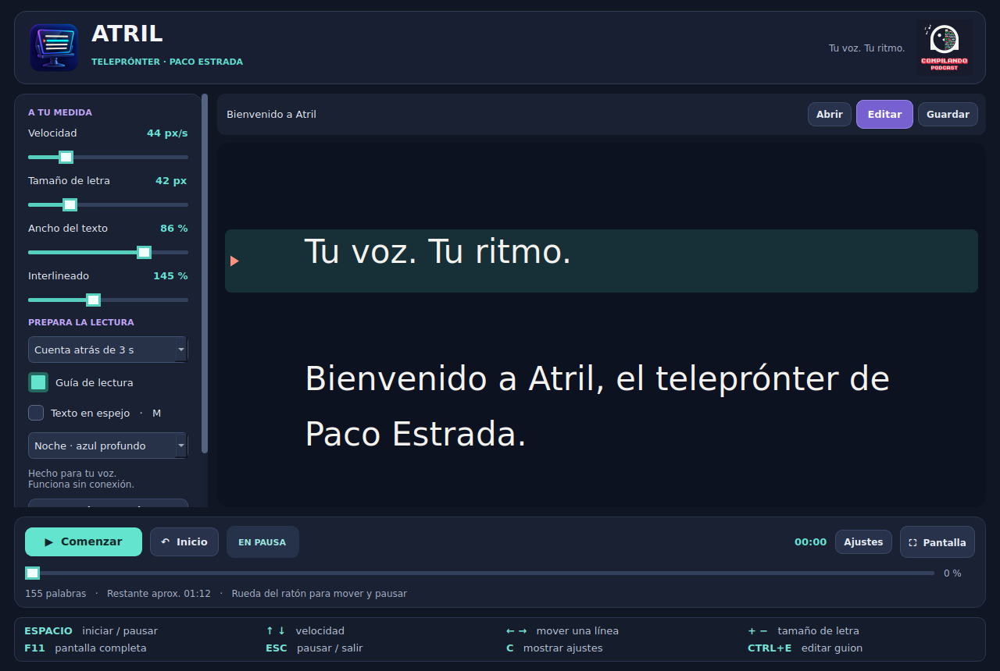

# Atril Teleprónter

**Tu voz. Tu ritmo.** Un teleprónter para GNU/Linux de **Paco Estrada · Compilando Podcast**.



Una aplicación de escritorio para locuciones, vídeos, presentaciones y pódcast. Funciona sin conexión, con letra grande, desplazamiento suave y controles de teclado y ratón. Tu nombre y el logo de Compilando permanecen en la cabecera; los atajos más utilizados siguen visibles durante la lectura y en pantalla completa.

## Descargas de la versión 1.0.0

| Plataforma | Release |
| --- | --- |
| GitHub | [Descargar .deb, .rpm y Arch Linux](https://github.com/pacoestrada/atril-teleprompter/releases/tag/v1.0.0) |
| GitLab | [Descargar .deb y .rpm](https://gitlab.com/PacoEstrada/atril-teleprompter/-/releases/v1.0.0) |

Descarga `.deb` para Linux Mint, Ubuntu y Debian, `.rpm` para Fedora o `.pkg.tar.zst` para Arch Linux. Los paquetes llevan las mismas fuentes de la versión 1.0.0. `SHA256SUMS.txt` comprueba DEB/RPM y `SHA256SUMS-arch.txt` los archivos de Arch.

## Instalar en Linux Mint, Ubuntu o Debian

Descarga `atril-teleprompter_1.0.0_all.deb` y ábrelo con el instalador de paquetes. También puedes instalarlo desde la carpeta de descarga con:

```bash
sudo apt install ./atril-teleprompter_1.0.0_all.deb
```

Después busca **Atril Teleprónter** en el menú de aplicaciones. El ejecutable se llama `atril-teleprompter` para no interferir con el visor de documentos Atril.

Necesita Python 3.10 o posterior y PyQt5 5.15. El gestor de paquetes instala estas dependencias. Puede necesitar conexión para descargarlas; la aplicación funciona completamente sin conexión una vez instalada. No incorpora servidor, cuenta de usuario ni servicios externos.

## Instalar en Fedora

```bash
sudo dnf install ./atril-teleprompter-1.0.0-1.noarch.rpm
```

El RPM declara las dependencias `python3` y `python3-qt5`. Está preparado para Fedora; no se afirma compatibilidad con todas las distribuciones que usan RPM. No se convierte a partir del paquete Debian.

## Instalar en Arch Linux

Descarga `atril-teleprompter-1.0.0-1-any.pkg.tar.zst` desde la
[release de GitHub](https://github.com/pacoestrada/atril-teleprompter/releases/tag/v1.0.0).
Desde la carpeta de descarga, con Arch actualizado:

```bash
sudo pacman -Syu
sudo pacman -U ./atril-teleprompter-1.0.0-1-any.pkg.tar.zst
```

El paquete está construido de forma nativa con `makepkg`. Pacman instala
Python y PyQt5 si faltan. También puedes reconstruirlo e instalarlo con la
receta incluida en el repositorio:

```bash
sudo pacman -Syu --needed base-devel git
git clone https://github.com/pacoestrada/atril-teleprompter.git
cd atril-teleprompter/packaging/arch
less PKGBUILD
makepkg -si
```

Ejecuta `makepkg` sin `sudo`. La receta verifica las fuentes de la versión
1.0.0 y ejecuta las pruebas antes de generar el paquete. No está publicada
en AUR. Consulta las [instrucciones de Arch](packaging/arch/README.md) para
instalar un paquete ya construido, comprobarlo o desinstalarlo.

## Empezar

1. Pulsa **Editar** para escribir o pegar tu guion, o **Abrir** para importar un archivo.
2. Ajusta el tamaño de letra, el ancho y la velocidad. Elige una cuenta atrás si la necesitas.
3. Pulsa **Espacio** o **Comenzar**. Pulsa de nuevo para pausar.
4. Usa **F11** para pantalla completa y **C** para ocultar o mostrar los ajustes.

El punto de lectura, el texto y los ajustes se guardan automáticamente en este ordenador. Al abrir de nuevo, la sesión queda en pausa. **Guardar** exporta el texto; **Ctrl+Mayús+S** guarda una sesión `.atril` con sus ajustes y posición para llevarla a otro equipo.

Al sustituir el guion, se conserva una copia del anterior. **Recuperar guion anterior**, en el panel de ajustes, permite recuperarlo. Es una sola copia de recuperación, no un historial ilimitado.

## Funciones

- Desplazamiento con reloj monotónico, pausa y continuación.
- Cuenta atrás de cero a cinco segundos al comenzar desde el inicio.
- Ajustes de velocidad, tamaño, ancho e interlineado.
- Temas Noche, Papel y Contraste para la zona de lectura.
- Guía visual y espejo horizontal del texto para un cristal de teleprónter.
- Barra para buscar un punto del guion, tiempo de lectura transcurrido y estimación del tiempo restante.
- Editor integrado, importación de TXT, Markdown como texto literal, DOCX y ODT.
- Recuperación de sesión, exportación TXT UTF-8 y sesiones portátiles `.atril`.
- Soporte de escalado de pantalla de Qt; ventana inicial limitada al área disponible.

## Atajos

| Tecla | Acción |
| --- | --- |
| Espacio o clic en el texto | Iniciar o pausar |
| ↑ / ↓ | Aumentar o reducir velocidad |
| ← / → | Retroceder o avanzar una línea |
| RePág / AvPág | Retroceder o avanzar una pantalla |
| + / − | Aumentar o reducir el tamaño de letra |
| Inicio / Fin | Ir al principio o al final |
| Rueda del ratón | Desplazarse y pausar |
| F11 | Entrar o salir de pantalla completa |
| Esc | Pausar y salir de pantalla completa |
| C | Mostrar u ocultar ajustes |
| M | Activar o desactivar el espejo |
| Ctrl+E | Editar o pegar guion |
| Ctrl+O | Abrir archivo |
| Ctrl+S | Exportar texto |
| Ctrl+Mayús+S | Exportar sesión `.atril` |
| Ctrl+N | Crear guion vacío |
| F1 | Mostrar ayuda |

Los atajos de lectura quedan inactivos mientras se escribe en el editor. Los controles admiten navegación con Tab y tienen nombres accesibles.

## Datos y privacidad

No se envía ningún texto ni dato de uso. La sesión reside en `~/.local/state/atril-teleprompter/session.json` (o bajo `XDG_STATE_HOME`, si está definido). `previous.atril` contiene el guion sustituido por última vez. Son archivos locales de texto sin cifrar. Desinstalar el paquete no elimina tus guiones.

El guardado usa un archivo temporal y un reemplazo atómico para evitar sesiones incompletas. Una sesión ilegible se conserva y la recuperación se escribe por separado.

## Alcance de la versión 1.0.0

El avance es a velocidad fija, expresada en píxeles lógicos por segundo; no sigue la voz. El tiempo restante es aproximado. Atril no graba audio ni vídeo, no sincroniza con la nube y no ofrece una segunda ventana independiente para otro monitor. Puede moverse a otro monitor como cualquier ventana de escritorio.

La importación de Word y LibreOffice extrae texto, no reproduce su maquetación, imágenes ni estilos. Admite documentos de hasta 8 MB y guiones de hasta un millón de caracteres. Conviene revisar el texto importado antes de una lectura. PDF y el antiguo formato `.doc` no se admiten.

## Ejecutar desde el código

```bash
sudo apt install python3 python3-pyqt5
python3 atril.py
```

Puedes pasar un guion como argumento: `python3 atril.py mi-guion.txt`. `--help` y `--version` funcionan sin abrir una ventana.

## Validación y empaquetado

```bash
QT_QPA_PLATFORM=offscreen python3 -m unittest discover -s tests -v
python3 packaging/build_deb.py
python3 packaging/build_rpm.py
```

Las pruebas cubren importación, caracteres españoles, límites de archivos, rechazo de entidades XML, recuperación de sesiones, reproducción y pausa, cuenta atrás, atajos, edición sin interferencias, recuperación del guion anterior y disposición en pantalla de portátil. La revisión visual se realiza con Qt en modo de pruebas; la comprobación final en una sesión real de Linux Mint, con su compositor y sus monitores, queda pendiente de uso.

Para construir el RPM se necesita `rpmbuild` (paquete `rpm-build` en Fedora o `rpm` en Ubuntu). El proceso de publicación de GitHub ejecuta las pruebas, construye ambos paquetes desde el mismo commit y adjunta sus sumas SHA-256. La publicación se inicia manualmente desde Actions y no sustituye una release existente.

La construcción de Arch se ejecuta en un contenedor Arch Linux: verifica las fuentes, ejecuta las 23 pruebas, instala el paquete con `pacman` y repite las pruebas sobre los archivos instalados. Después añade el paquete y sus sumas a la release 1.0.0 sin reemplazar los DEB/RPM. La prueba de lectura en un escritorio Arch real sigue pendiente.

## Autoría y licencia

Paco Estrada · [Compilando Podcast](https://compilando.es).

Código bajo **GPL-3.0-or-later**, compatible con la distribución libre de PyQt5. Consulta [LICENSE](LICENSE) y [THIRD_PARTY.md](THIRD_PARTY.md) para dependencias e identidad gráfica.

Referencias de implementación: [QTextDocument](https://doc.qt.io/archives/qt-5.15/qtextdocument.html) y [escalado de Qt](https://doc.qt.io/archives/qt-5.15/highdpi.html).
